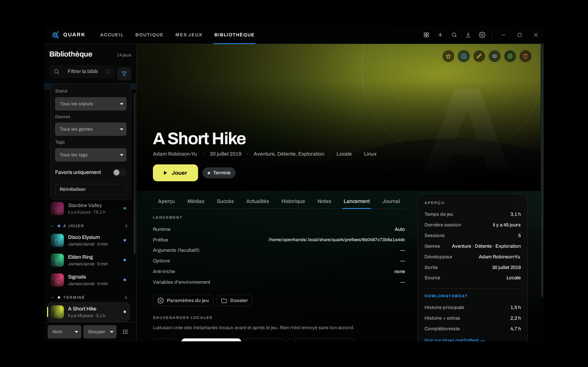

# Quark

A lightweight game launcher for Linux, written in Rust with a Tauri 2 interface. Quark keeps a
single library for local games and for the Steam, Epic Games, GOG and itch.io
titles you own, launches Windows games through Proton (or umu-launcher), and stays out of
the way with a modern dark interface, a fast library and a detailed game page.

This is the **2.0.1** documentation. Older release notes are kept on the GitHub
releases page; `docs/release-notes.md` only describes the release currently
being published.

**Website:** [matheotaku4.github.io/Quark](https://matheotaku4.github.io/Quark/) ·
**Documentation:** [GitHub Wiki](https://github.com/Matheotaku4/Quark/wiki) ·
[Getting started](https://github.com/Matheotaku4/Quark/wiki/Getting-Started) ·
[Proton and Wine options](https://github.com/Matheotaku4/Quark/wiki/Proton-Wine-and-Launch-Options) ·
[Troubleshooting](https://github.com/Matheotaku4/Quark/wiki/Troubleshooting).
The wiki is published from the versioned source in [`wiki/`](wiki/) by the
`.github/workflows/wiki.yml` workflow.

## What's new in 2.0.1

- **Lighter interface.** Clearer library search, tab animations, a two-tab
  Metadata/Images customizer and lazy cover loading in My games.
- **Video fullscreen fixed.** Trailers use a built-in cinema mode instead of the
  WebKitGTK native fullscreen that showed a black screen.
- **Window and memory.** Left-click the notification icon to open Quark,
  right-click to close it, and the background WebView is destroyed to release
  memory.
- **Clearer settings.** Default game tab, plus gamescope/umu options greyed out
  when their switch is off.
- **Russian added** to the interface and Rust core messages.
- **Quark overlay removed.** The global screenshot shortcut remains available.

## Table of contents

1. [What's new in 2.0.1](#whats-new-in-201)
2. [What Quark does](#what-quark-does)
3. [Installation](#installation)
4. [First launch](#first-launch)
5. [Interface](#interface)
6. [One game, several installations](#one-game-several-installations)
7. [Stores, accounts and cloud saves](#stores-accounts-and-cloud-saves)
8. [Achievements and the Epic overlay](#achievements-and-the-epic-overlay)
9. [Proton, umu and launch options](#proton-umu-and-launch-options)
10. [Local saves and snapshots](#local-saves-and-snapshots)
11. [Settings](#settings)
12. [Command line](#command-line)
13. [Files, data and privacy](#files-data-and-privacy)
14. [Project layout](#project-layout)
15. [Development and tests](#development-and-tests)
16. [Known limitations](#known-limitations)
17. [Licence](#licence)

## What Quark does

- **One library.** Local games and store games share covers, metadata, notes,
  tags, playtime and statistics. A game can have several installed editions
  without becoming two library entries.
- **Steam, Epic Games and GOG.** Steam is read from the local Steam libraries.
  Epic sign-in and library are direct; Legendary handles installation and
  launch. GOG uses gogdl, and itch.io uses a personal API key for the owned
  library and archive installs. Accounts are connected from the settings;
  passwords never pass through Quark.
- **Proton without command lines.** Per-game runtime, prefix, GameMode,
  MangoHud, gamescope, PRIME offload, a free wrapper command, environment
  variables, BattlEye/EasyAntiCheat runtimes and umu-launcher.
- **Achievements.** Steam, Epic and GOG progress is shown on the game page,
  with icons, rarity and session unlocks. The Epic overlay (EOS) can be
  installed in the game prefix from the store settings.
- **Cloud saves for Epic and GOG.** The account save is fetched after an
  installation, then synchronized again when the game exits, using the same
  upstream data as the official clients.
- **Local save snapshots.** Ludusavi creates verified snapshots before a launch
  and after a session, with preview, inventory and restore.
- **A sober, configurable interface.** Thirteen dark themes, six interface
  languages (French, English, Spanish, German and Portuguese), compact spacing
  and adjustable panel sizes, list or grid, a home carousel, a
  random blurred hero background, HowLongToBeat times in the game overview,
  status columns, tags, filters, a global search palette (Ctrl+K/Ctrl+F) and an embedded
  Archivo font with Lucide icons.

Quark is not a store: it never buys anything, and it never downloads or
extracts games from third-party download sites. Store search results open in
your browser.

## Installation

### Release archive

Download `quark-<version>-linux-x86_64.tar.gz` and its `.sha256` file from the
[latest release](https://github.com/Matheotaku4/Quark/releases/latest),
then verify and unpack it:

```bash
sha256sum -c quark-2.0.1-linux-x86_64.tar.gz.sha256
tar -xzf quark-2.0.1-linux-x86_64.tar.gz
./quark/quark
```

The archive contains `quark/quark`, `quark/README.md`, `quark/quark.desktop`
and `quark/quark.png`. To add Quark to the applications menu, install them for
the current user:

```bash
install -Dm755 quark/quark ~/.local/bin/quark
install -Dm644 quark/quark.desktop ~/.local/share/applications/quark.desktop
install -Dm644 quark/quark.png ~/.local/share/icons/hicolor/512x512/apps/quark.png
update-desktop-database ~/.local/share/applications 2>/dev/null || true
```

`~/.local/bin` must be in your `PATH` for the `Exec=quark` entry to work; if it
is not, use the absolute path of the binary in the desktop file. Quark needs
WebKitGTK 4.1 (`libwebkit2gtk-4.1-0`), GTK 3, the AppIndicator library
(`libayatana-appindicator3-1`, optional but required for the tray icon) and an
X11 or Wayland session.
`python3` is required by Legendary and gogdl (both are Python zipapps).
For inline trailers, install GStreamer with `gst-launch-1.0` and the HLS/H.264
plugins (`gstreamer1.0-tools`, `gstreamer1.0-plugins-good` and
`gstreamer1.0-libav` on Debian/Ubuntu). Without them, the Media tab shows the
thumbnail and offers the Steam page instead. The trailer volume slider also
needs `pactl` and a PulseAudio or PipeWire server; without it, the slider stays
hidden. If `pulsesink` cannot open the stream, Quark retries once with
`autoaudiosink`; the trailer plays but the slider stays hidden.

### Build from source

```bash
git clone https://github.com/Matheotaku4/Quark.git
cd Quark/quark-tauri
cargo build --release --locked
./target/release/quark-tauri
```

On Debian/Ubuntu, the Tauri build needs WebKitGTK, GTK and the usual Rust
build tools:

```bash
sudo apt-get install build-essential pkg-config libwebkit2gtk-4.1-dev \
  libgtk-3-dev librsvg2-dev libssl-dev libayatana-appindicator3-dev
```

## First launch

A new configuration opens a welcome panel. It is not blocking: **Later**
closes it. The panel sets the interface language, startup page, theme and store
games folder. Existing
configurations are marked as already welcomed, so updating from 1.1.4 never
shows it unexpectedly; they still see the 1.8 summary once.

1. Open **Settings → Stores & tools** and install Legendary and/or gogdl with
   **Install / update**. Quark verifies the SHA-256 digest published by GitHub
   before running a downloaded tool.
2. Connect Epic or GOG with the code copied from the browser page. For Epic,
   Quark exchanges the code itself; the credentials are stored locally in a
   private file and never sent to a Quark server.
3. Add a game with the **+** button, import the installed Steam library, or open
   **Stores** to browse what you own.
4. Pick a Proton runtime in **Settings → New games** if the automatic choice is
   not what you want. Every game can override it.

## Interface

### Home

Home is a page of its own, reached from the **Home** tab in the top bar. It has
no library sidebar: a full-width carousel of recently played games presents the
hero image, logo or title, a **Continue/Stop** button, playtime, last session,
ProtonDB rating and the native-Linux badge. Below it, the whole library is shown
as covers. The top bar keeps Home, Store, My games and Library; the library
sidebar and its **Filters** button appear in Library view. Sort the covers by
last session, date added or hours played. The **Filters** button opens one menu
for status, Steam genre and personal tag; it shows the number of active filters
and includes **Clear all**. The carousel can advance automatically; the delay is
set in **Settings → Appearance**.

**Startup page.** Settings → Appearance → **Startup page** decides what Quark
opens at launch: **Home** (the default), **Library**, **Store** or **My games**.
The choice is applied once when the window opens and is saved with the library;
an older configuration without the setting starts on Home.

**Random hero background.** Appearance → Background can reuse a library banner
as a blurred backdrop behind Home and Library. One banner is picked per session;
the blur radius is adjustable from 2 to 30 px and is part of the blur cache key.

### Library

The top bar switches between **Grid** and **List** with a labelled segmented
control, and the **Add** button sits next to it. A single search entry point in the top bar adapts to
narrower windows. The list shows one row per game with a square icon, a status
dot and a blue selection marker. The grid shows covers and opens the game page
as an overlay.
Games with a missing executable are highlighted in red. Right-click a game for
launch, customize, settings and remove; `Ctrl+click` marks several games for a
batch removal.

The **Views** menu stores the current search, filters, sort and grouping under
a name; apply or delete a view from the same menu. Three starter views (**À jouer**,
**En cours** and **Terminés**) are added once, then behave like any
other view. The **Filters** button groups status, Steam genre and tags in a
single popup instead of stacking chips above the list; active filters are
counted on the button and **Clear all** resets them. Group the list by status,
store, genre or release year, or show a continuous list; group headers can be
collapsed. Sort by name, last session, date added or play time. The global search
ignores accents, covers local games, owned store games and settings, and
requires a real substring so a query cannot scatter across unrelated fields.



Keyboard shortcuts: arrows navigate, `Enter` launches, `Ctrl+F` or `/` opens
the same global search as `Ctrl+K`, `Esc` closes it and `Ctrl+Q` really quits
Quark. The search runs from any tab: type to find pages, actions, local games,
owned store games and settings, use `↑`/`↓` to move, `Enter` to open and `Esc`
to close.

### Game page

The page shows the hero banner, ProtonDB/native badges, the **Play** button with
playtime, media, achievements and history tabs. The **Media** tab plays the Steam
trailer inline and lists it before the screenshots in a horizontal filmstrip;
clicking a screenshot replaces the video, clicking the video starts it again.
The information button stays on the banner; per-game settings, customization,
the session log and removal live
in a single **···** menu (removal still asks for confirmation). **History**
summarises the game's sessions, shows the last twelve weeks and lists its latest
play sessions.
**Customize** replaces or
removes the cover, hero, logo and icon; images can come from SteamGridDB,
Steam, the store itself, or a local file.

### Stores

The **Stores** tab is a Steam discovery page: featured deal, recommendations,
the most played games, top sellers, specials, new releases and upcoming titles.
Prices are regional and the store page opens in your browser. A game card also
offers a search on the download sites supported by Quark; results only open the
site in your browser.

### My games / Stores library

**My games** lists the titles you own or have installed on Steam, Epic and GOG,
one tab per store, sorted by name, with a search field and store covers. A left
or right click on an uninstalled game opens the install sheet; an installed game
opens its actions. Up to three Epic/GOG downloads run at once, each with its own
progress, speed, ETA and **Cancel** button. The download icon in the top bar
lists every transfer.
The segmented control next to the search field switches between the cover grid
and a **List** view with one row per game, an **Open** / **Install** button and
a **···** menu with the same actions as the right-click menu.

## One game, several installations

Quark 1.1 introduces a `Game → Installations` model. A `Game` carries the
shared data (name, artwork, notes, favorite, tags, status, playtime, sessions); each
`Installation` carries one edition:

- store or local source, product ID and install folder;
- executable and Proton prefix;
- cloud-save folder and GOG synchronization timestamp;
- installed state and last sync time.

The first launch migrates an existing configuration automatically: the old
`exe` field becomes a local installation, and every linked store record becomes
an edition of the same game. The migration is idempotent and runs before each
save, so an interrupted migration cannot duplicate entries.

The game information panel lists the editions. Selecting one changes the
executable and prefix used by **Play**, without touching the other edition.
When the historical `~/.local/share/quark/prefixes/<game>` prefix already exists,
it is reused so that existing saves stay visible after switching from a local
copy to a store edition. A genuinely new second installation gets its own
`<game>-<store>` prefix instead. This keeps a Steam copy and a GOG copy of the
same title usable with separate launch state while preserving the historical
saves.

The legacy fields (`exe`, `prefix`, `proton`, …) are still serialized for
compatibility and remain the values used by the launch resolver. The active
installation is the source of truth when it is selected.

## Stores, accounts and cloud saves

### Accounts

- **Steam** is read locally from `libraryfolders.vdf` and
  `appmanifest_*.acf`. A personal Steam Web API key and SteamID64 are optional;
  they improve recommendations and unlock the Steam achievement tab.
- **Epic Games** signs in directly: Quark exchanges the authorization code,
  writes the resulting `user.json` for Legendary, and reads the owned library
  itself through Epic's launcher API. The session is refreshed automatically.
  Legendary remains the installation and launch backend.
- **GOG** uses gogdl. Its token file is separate from Quark's
  `credentials.json` and is written with private permissions.
- **itch.io** uses a personal API key, stored in the private credentials file.
  Quark lists `profile/owned-keys`, selects a Windows archive from the game's
  uploads, downloads it and extracts it without executing the archive.

The managed tools are downloaded from their official GitHub releases. Quark
refuses an asset without a published SHA-256 digest and never trusts a
mismatched binary.

### Cloud saves

Cloud synchronization is enabled by default in **Settings → In game**.

- **Epic:** Quark runs `legendary -y sync-saves <app> --accept-path`. Legendary
  compares the local save folder with the cloud manifest; the newer side wins.
  A custom save folder can be supplied with `--save-path`.
- **GOG:** Quark runs `gogdl save-sync <folder> <game-id> --ts <timestamp>`.
  gogdl requires a folder, so choose one in the game information panel or in
  **My games → Save folder**. The timestamp returned by gogdl is stored in the
  installation and reused for the next comparison.
- **Steam:** Steam Cloud stays inside the Steam client. Quark does not read or
  write Steam's cloud saves.

The synchronization runs after a successful Epic/GOG installation and after a
game launched by Quark exits. It is asynchronous, so it never blocks the
interface. The game information panel also has a manual **Synchronize cloud
saves** button and shows the last result. A save is never invented: when no
local or remote save exists, the panel says so.

## Achievements and the Epic overlay

### Achievements

Epic achievements are read with `legendary achievements <app> --json`. The
parser accepts log lines around the JSON, null lists and the older plain-text
table (`Total achievements`, `Completed`, `In progress`). If the metadata cache
is incomplete, Quark refreshes it with `legendary info` and retries once. A
missing session or a game without achievements now produces an explicit message
instead of an unreadable-response error.

GOG achievements come from `gameplay.gog.com` with the gogdl session. Both
sources are normalized to the same rows, with icons cached locally, rarity when
published, and a **session** badge for achievements reported during play.

A game can report an unlock through the local bridge:

```bash
curl -X POST "$QUARK_ACHIEVEMENTS_URL" \
  -H "Authorization: Bearer $QUARK_ACHIEVEMENTS_TOKEN" \
  -d '{"game":"'"$QUARK_GAME_ID"'","achievement":"ACH_FIRST","name":"First step"}'
```

The listener only binds `127.0.0.1`; the token changes on every launch and is
masked in the session log.

## Proton, umu and launch options

Quark detects Proton builds under `steamapps/common/Proton*` and
`compatibilitytools.d/`, including Flatpak and Snap installations. A runtime can
be selected per game or as a default. The selected prefix is used as-is; only
the automatic fallback creates `~/.local/share/quark/prefixes/<game>`.

Per-game launch options are checkboxes, not command lines:

- **GameMode** (`gamemoderun`);
- **MangoHud** (`MANGOHUD=1`);
- **gamescope** with resolution, FSR and frame limit;
- **PRIME offload** for hybrid laptops;
- a free **wrapper** command where `%command%` is replaced by the game command;
- `PROTON_LOG=1`;
- **umu-launcher** with `WINEPREFIX`, `GAMEID` and `PROTONPATH`.

A missing optional tool is reported and ignored; the game still starts. The
BattlEye and EasyAntiCheat runtimes are passed to Proton through
`PROTON_BATTLEYE_RUNTIME` and `PROTON_EAC_RUNTIME`.

## Local saves and snapshots

The save panel is shared by the library and **My games**. It supports custom
save folders, a Ludusavi preview, a full backup, a backup inventory and restore.
Snapshots are taken before a launch and after a session. The restore preview is
validated against the game's install roots; symlinks, `$HOME` as a root and
paths outside the allowed roots are refused. Each provider installation has its
own Ludusavi bucket, so two editions of the same title never share a snapshot.

Ludusavi is downloaded from its official release and verified before use.
Quark never replaces an unreadable Ludusavi configuration; it reports the error
and keeps the file.

## Settings

Settings occupy the whole window, with a left sidebar and sections separated by
accented headings. A search field above the sidebar finds a setting by task
(for example **cloud saves** or **screenshots**) and jumps to the right page. The
content scrolls independently and `Esc` or the top-right **×** closes the page.

- **Appearance:** interface language, 13 themes, interface size (compact mode,
  sidebar, rows, covers, banner and overview widths), random hero background,
  startup page, list/grid, carousel, notification icon.
- **In game:** screenshot shortcut, achievement display and cloud-save
  toggle.
- **New games:** defaults copied into each newly added game.
- **Artworks:** image sources, SteamGridDB key and cache.
- **Stores & tools:** sync, accounts, managed tools and the EOS overlay.
- **Statistics** and **Disk space:** play history and storage measurements.
- **About:** version, updates, release link, guide and what's-new actions.

**Appearance** contains the startup page, interface language, 13-theme grid,
interface size controls, random hero background, default view, default game
tab, home carousel and notification icon. **In game** contains the screenshot
shortcut, achievement display and cloud-save toggle. **New games** contains the values copied into
each newly added game (prefix, install folder, arguments, runtime, anti-cheat,
launch options, environment variables). These are defaults, not global
settings: changing one never modifies an existing game.

**Stores & tools** contains synchronization, accounts, managed tool
installation and the actions that require a store session. **Statistics**
shows total playtime, the week, the streak, twelve weeks of bars, a 26-week
heat map and the most played games. **Disk space** measures prefixes, artwork,
logs, updates and game folders in a background thread.

**About** contains the installed version and update settings. On startup,
Quark checks the latest GitHub release when **Install updates at startup** is
enabled (the default), verifies the SHA-256 and the new binary, replaces the
executable in place and relaunches itself. It keeps the previous executable
next to the new one until the next successful start. The automatic path is
skipped for development builds and read-only installs; a game running in Quark
blocks the install. Use **Check for updates** to do it manually. 1.1.4 and
later install subsequent releases automatically with the same archive format;
the manual archive remains available for read-only installs and for a recovery.

## Command line

```text
quark                     Open the launcher
quark --doctor            Check the local environment
quark launch <game>       Launch a game without opening the UI
quark list                List the library for scripts
quark --search <query>    Search Steam / SteamGridDB without opening the UI
quark --fetch <name>      Search a title and download its artwork
quark --news <appid|name> Read the Steam news feed
quark --scan <folder>     Scan a folder for games
quark --update            Check and download the latest release archive
quark --ui <file.png>     Render the interface off-screen (no display needed)
quark --tray              Run the notification-icon process
```

`quark launch` matches an exact title first, then a case-insensitive substring,
and exits with code 1 when the title is ambiguous or unknown. `quark list` prints
the status and playtime of every game.

`--ui` accepts `--demo`, `--view`, `--group`, `--tab`, `--theme`, `--lang`,
`--select`, `--dialog`, `--hero-bg`, `--blur`, `--size`, `--frames`, `--hover`,
`--click` and `--key`; `--demo` uses a temporary configuration and never reads or
writes the real library. `--group` accepts `status`, `store`, `genre`, `year` or
`none`; `--lang` accepts `fr`, `en`, `de`, `es` or `pt`; `--blur` is a 2–30 px radius.
`--dialog` includes `onboarding`, `onboarding-settings` and `whats-new` for the
new screens.

## Files, data and privacy

| Path | Contents |
| --- | --- |
| `~/.config/quark/config.json` | Settings, library, installations and play history |
| `~/.config/quark/credentials.json` | Optional Steam Web API key and SteamID64 |
| `~/.config/quark/legendary/user.json` | Epic session written by Legendary |
| `~/.local/share/quark/gogdl-auth.json` | GOG tokens written by gogdl |
| `~/.local/share/quark/artwork/` | Cached artwork and achievement icons |
| `~/.local/share/quark/prefixes/` | Automatic Proton prefixes |
| `~/.local/share/quark/logs/<game>/` | Session logs, mode `0600` |
| `~/.local/share/quark/save-backups/` | Ludusavi snapshots |
| `~/.local/share/quark/updates/` | Downloaded update archives |

Library writes are atomic (`fsync` + rename) and retried when they fail. A
corrupt `config.json` is copied aside and the library becomes read-only instead
of being overwritten with an empty one. Session logs never contain environment
values, full command lines or the achievement token. Quark has no server and
does not send telemetry.

## Project layout

```text
src/
  lib.rs              core library consumed by the Tauri application
  config.rs           library, settings, Game and Installation models
  i18n.rs             multilingual catalogues and dynamic labels
  providers/          Steam, Epic (direct library + Legendary), GOG (gogdl),
                      itch.io (API key),
                      achievements, cloud_saves, artwork and managed tools
  providers/epic_account.rs  direct Epic OAuth exchange and session file
  proton.rs           runtime detection, prefix resolution and launch options
  session.rs          process groups and session logs
  saves/              Ludusavi integration and snapshot validation
quark-tauri/
  src/main.rs         Tauri commands, session manager and quarkimg:// protocol
  src/themes.rs       theme definitions exposed to the webview
  ui/                 HTML, CSS and JavaScript interface
  icons/              window and application icons
  tauri.conf.json     window, security and bundle configuration
assets/i18n/         French source plus English, Spanish, German, Portuguese and Russian
docs/
  release-notes.md    notes for the current release only
site/                 static landing page published by GitHub Pages
wiki/                 GitHub Wiki source: guides, Proton variables, help
.github/workflows/
  rust.yml            tests and checks
  release.yml         build and GitHub release
  pages.yml           publish site/ to GitHub Pages
```

## Development and tests

```bash
cargo fmt --all --check
cargo clippy --all-targets --locked -- -D warnings
cargo test --locked

cd quark-tauri
cargo fmt --check
cargo clippy --all-targets --locked -- -D warnings
cargo build --release --locked
```

The release workflow builds the Tauri binary on Ubuntu 22.04 and creates the
GitHub release from `docs/release-notes.md`. The release notes file contains
only the version currently being published; previous notes stay on their
existing GitHub releases.

## Known limitations

- Steam achievements are read through the public Steam Web API and require a
  personal API key plus SteamID64 in **Settings → Stores & tools**. Private
  profiles, games without stats and rate-limited requests are reported in the
  achievement panel. Steam Cloud is left to the Steam client.
- GOG cloud saves need an explicit save folder; gogdl cannot infer it from the
  installation path. Epic can compute its path with Legendary.
- Inline trailer playback needs GStreamer and its HLS/H.264 plugins; the archive
  does not bundle them. The volume slider additionally needs `pactl` and a
  PulseAudio or PipeWire server. If `pulsesink` fails before the first frame,
  Quark retries with `autoaudiosink`; the slider is then hidden. The media
  gallery remains limited to Steam-linked games.
- Epic installation and launch still go through Legendary. The direct session
  removes the Legendary requirement for the library, not for those two actions.
- itch.io installs only archives (`.zip`, `.tar`, `.tar.gz`, `.tgz`). An upload
  that exists only as an `.exe`, `.dmg` or `.apk` installer must be installed
  manually; Quark never runs an opaque installer. itch.io exposes neither
  achievements, cloud saves nor playtime through its API.
- Real Epic/GOG accounts and a graphical X11 session are not available in the
  development environment. The parsers, argument construction, migration and
  error paths are covered by tests; a manual account test is still required
  before claiming a complete end-to-end validation.
- Native Wayland global shortcuts depend on the compositor. The screenshot
  shortcut is ignored when the compositor refuses a global key.
- Cloud synchronization is deliberately opt-in by store capability. Quark never
  invents a remote save or marks a synchronization successful when the provider
  returned an error.

## Licence

Quark is distributed under the MIT licence. The embedded Archivo font is under
the SIL Open Font License; the Lucide icon font is under the ISC licence. See
`assets/fonts/` and the release notes for the exact files.
