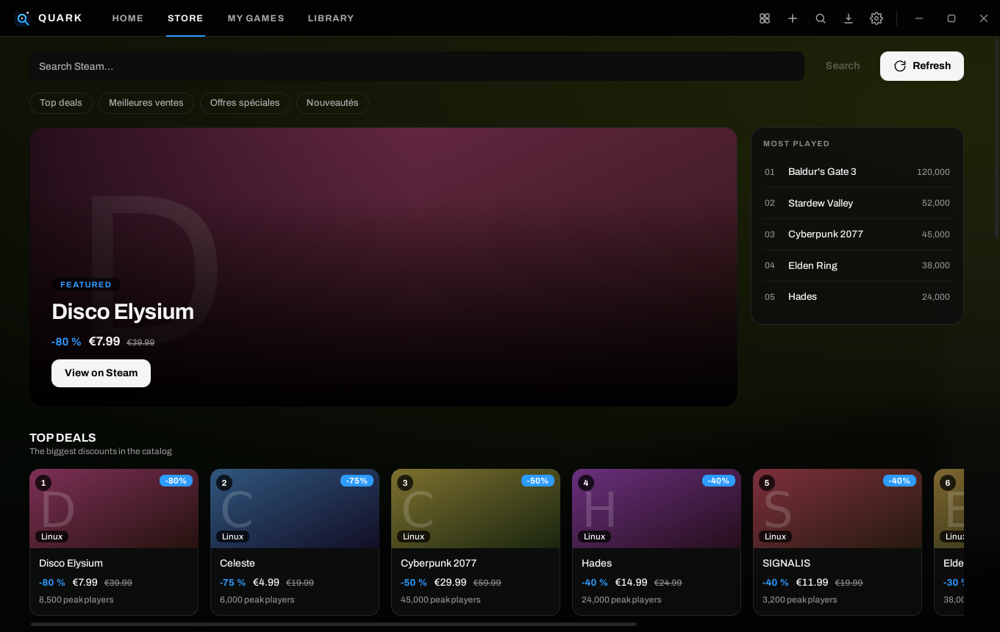
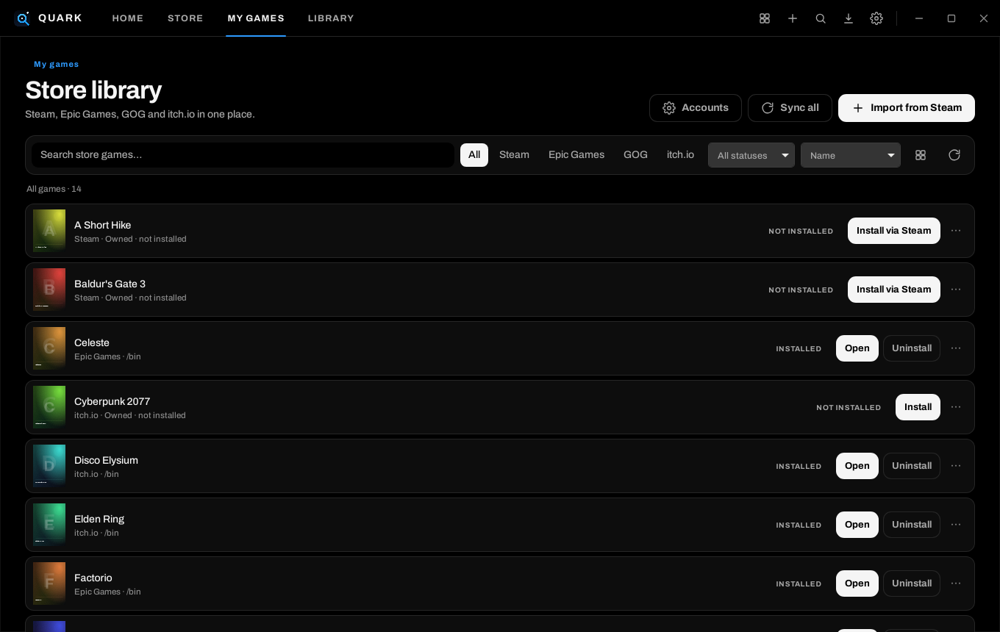
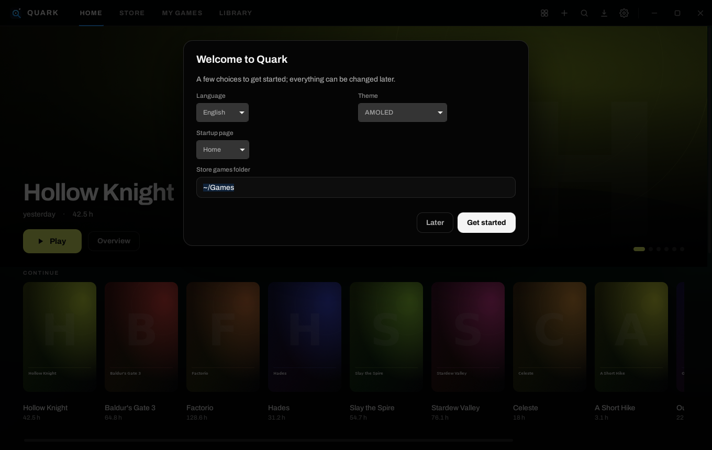

# Quark Wiki

Quark is a game launcher for Linux, written in Rust with a Tauri 2 interface.
It brings local games and your Steam, Epic Games, GOG and itch.io libraries
together, launches Windows games through Proton or umu-launcher, and keeps
achievements and verified local saves alongside the library.

This documentation describes **Quark 2.1.1**. Its source is versioned in the
repository under [`wiki/`](https://github.com/Matheotaku4/Quark/tree/main/wiki).

## Preview

| Library | Game page |
| --- | --- |
|  |  |
| **Store** | **My games** |
|  |  |
| **Site search** | **Settings** |
|  |  |
| **First launch** | **Home** |
|  |  |

## What's new in 2.1.1

- **AnkerGames search restored.** The site rejected non-browser clients with
  HTTP 403; Quark now sends the origin, referer and browser user agent it
  expects.
- **Safer artwork loading.** WebP dimensions come from the header (VP8X, VP8,
  VP8L) and the decode fallback is capped at 8192 px and 64 MiB.
- **Everything from 2.1.0.** Faster My games, the seven-source search, the
  toggleable notification icon and Proton recovery are unchanged.

## Where to start

| I want to… | Page |
| --- | --- |
| Install or update Quark | [Installation](Installation) |
| Learn the first launch, library and basic settings | [Getting started](Getting-Started) |
| Understand the list, grid, views and filters | [Library and views](Library-and-Views) |
| Use Steam, Epic, GOG, accounts and cloud saves | [Stores and saves](Stores-and-Saves) |
| Configure Proton, umu, Wine, variables and launch options | [Proton, Wine and launch options](Proton-Wine-and-Launch-Options) |
| Change themes, language or startup page | [Themes and appearance](Themes-and-Appearance) |
| Read achievements and the Epic overlay | [Achievements](Achievements) |
| Find every settings page | [Settings](Settings) |
| Fix a game that will not start, a missing text or a save issue | [Troubleshooting](Troubleshooting) |

## What Quark does

- **One library.** Local and store games share covers, hero images, logos,
  notes, favorites, tags, playtime and statistics. A game can have several
  installations without appearing twice.
- **Steam, Epic Games and GOG.** Steam is read from local libraries. Legendary
  manages Epic and gogdl manages GOG. Passwords never pass through Quark; only
  the tokens written by those tools stay on the machine.
- **Proton without command lines.** Per-game runtime, prefix, GameMode,
  MangoHud, gamescope, PRIME, a free wrapper command, environment variables,
  anti-cheat runtimes and umu-launcher.
- **Achievements.** Epic and GOG achievements share the same view on the game
  page, with icons, rarity and session unlocks.
- **Saves.** Epic/GOG cloud synchronization and Ludusavi snapshots verified
  before and after a session.
- **A configurable interface.** Thirteen dark themes, six interface languages
  (French, English, Spanish, German, Portuguese and Russian), list or grid, a
  customizable home page and a `Ctrl+K` command palette.
- **A launcher, not a store.** Quark never buys anything and never downloads a
  game from a third-party site. Store search results open in your browser.

## Essential shortcuts

| Shortcut | Action |
| --- | --- |
| `Ctrl+K` | Global search: pages, actions, games and settings |
| `Ctrl+F` or `/` | Global search (games, stores, settings) |
| `Escape` | Close a search, panel or the cinema player |
| `Enter` | Launch the selected game |
| Arrow keys | Move through the library |
| `Ctrl+Q` | Quit Quark |

## About this documentation

- Screenshots come from the `--demo` mode: their covers are deliberately
  neutral placeholders, not the real game artwork.
- Epic/GOG accounts and a real graphical server are not available in the build
  environment. Code paths, migrations and errors are tested, but a manual check
  with a real account is still recommended.
- The wiki is published from the versioned source in `wiki/`. Pages are kept in
  step with the current release; old release-specific notes are removed.

## Licence

Quark is distributed under the MIT licence. The Archivo font is under the SIL
Open Font License and the Lucide icons under ISC. See
[`assets/fonts/`](https://github.com/Matheotaku4/Quark/tree/main/assets/fonts)
and the release notes for the exact files.

---

[Installation](Installation) · [Getting started](Getting-Started) ·
[Library](Library-and-Views) · [Stores](Stores-and-Saves) ·
[Proton and Wine](Proton-Wine-and-Launch-Options) ·
[Themes](Themes-and-Appearance) · [Achievements](Achievements) ·
[Settings](Settings) · [Troubleshooting](Troubleshooting)
