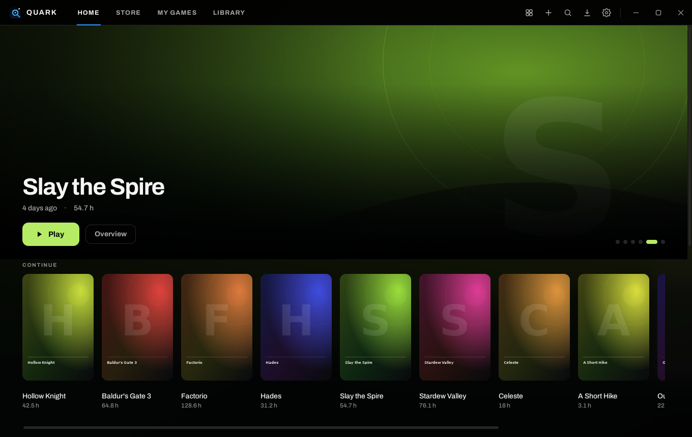

# Quark Wiki

Quark is a game launcher for Linux, written in Rust with a Tauri 2 interface. It brings local
games and your Steam, Epic Games and GOG libraries together, launches Windows
games through Proton or umu-launcher, and adds an in-game overlay,
achievements and verified local saves.

This documentation describes **Quark 1.8.8**. It is also versioned in the
repository under [`wiki/`](https://github.com/Matheotaku4/Quark/tree/main/wiki).

## What's new in 1.8.8

- **Automatic audio fallback.** If `pulsesink` fails before the first frame,
  the player retries once with `autoaudiosink` (PipeWire, ALSA or another
  available output) instead of showing an error. The fallback never overrides
  `QUARK_GST_AUDIO_SINK`, never restarts a video that already started, and
  hides the volume slider when the fallback output cannot be controlled.
- **GOG adoption matches real manifests.** Adoption requires the primary task's
  executable and every game-category executable, including hidden tasks behind
  a launcher. Optional manuals, configuration tools and URLTask entries no
  longer block a complete install; Windows paths, double separators and case
  differences are still resolved.
- **Four multi-playTasks manifests covered.** Beneath a Steel Sky, Trails in the
  Sky SC, Prison Architect and The Witcher 3 exercise adoption, optional tasks,
  hidden tasks and launcher-primary installs.
- **Tests:** 362 unit tests, plus 4 live network tests run separately (a real
  HLS trailer, Steam media, GOG pack resolution and the game's Windows builds).

## Where to start

| I want to… | Page |
| --- | --- |
| Install or update Quark | [Installation](Installation) |
| Learn the first launch, library and basic settings | [Getting started](Getting-Started) |
| Understand the list, grid, views and filters | [Library and views](Library-and-Views) |
| Use Steam, Epic, GOG, accounts and cloud saves | [Stores and saves](Stores-and-Saves) |
| Configure Proton, umu, Wine, variables and launch options | [Proton, Wine and launch options](Proton-Wine-and-Launch-Options) |
| Change themes, language, hero background or startup page | [Themes and appearance](Themes-and-Appearance) |
| Use the overlay and achievements | [Overlay and achievements](Overlay-and-Achievements) |
| Find every settings page | [Settings](Settings) |
| Fix a game that will not start, a missing text or a save issue | [Troubleshooting](Troubleshooting) |

## What Quark does

- **One library.** Local and store games share covers, hero images, logos,
  notes, favorites, tags, playtime and statistics. A game can have several installations
  without appearing twice.
- **Steam, Epic Games and GOG.** Steam is read from local libraries. Legendary
  manages Epic and gogdl manages GOG. Passwords never pass through Quark; only
  the tokens written by those tools stay on the machine.
- **Proton without command lines.** Per-game runtime, prefix, GameMode,
  MangoHud, gamescope, PRIME, a free wrapper command, environment variables,
  anti-cheat runtimes and umu-launcher.
- **A real overlay.** `Shift+Backspace` opens a compact panel above the game.
  Epic and GOG achievements share the same view.
- **Saves.** Epic/GOG cloud synchronization and Ludusavi snapshots verified
  before and after a session.
- **A configurable interface.** Thirteen dark themes, five interface languages, list or
  grid, a customizable home page, a random blurred hero and a `Ctrl+K` command
  palette.
- **A launcher, not a store.** Quark never buys anything and never downloads a
  game from a third-party site. Store search results open in your browser.

## Essential shortcuts

| Shortcut | Action |
| --- | --- |
| `Ctrl+K` | Global search: pages, actions, games and settings |
| `Ctrl+F` or `/` | Global search (games, stores, settings) |
| `Escape` | Close a search, panel or the overlay |
| `Enter` | Launch the selected game |
| Arrow keys | Move through the library |
| `Shift+Backspace` | Open or close the in-game overlay |
| `Ctrl+Q` | Quit Quark |

## About this documentation

- Screenshots come from the `--demo` mode: their covers are deliberately
  neutral placeholders, not the real game artwork.
- Epic/GOG accounts and a real graphical server are not available in the build
  environment. Code paths, migrations and errors are tested, but a manual check
  with a real account is still recommended.
- The GitHub wiki is a separate repository. Publishing it needs GitHub
  authentication with wiki access; the source is versioned here so it can be
  synchronized as soon as that access is available.

## Licence

Quark is distributed under the MIT licence. The Archivo font is under the SIL
Open Font License and the Lucide icons under ISC. See
[`assets/fonts/`](https://github.com/Matheotaku4/Quark/tree/main/assets/fonts)
and the release notes for the exact files.

---

[Installation](Installation) · [Getting started](Getting-Started) ·
[Library](Library-and-Views) · [Stores](Stores-and-Saves) ·
[Proton and Wine](Proton-Wine-and-Launch-Options) ·
[Themes](Themes-and-Appearance) · [Overlay](Overlay-and-Achievements) ·
[Settings](Settings) · [Troubleshooting](Troubleshooting)
