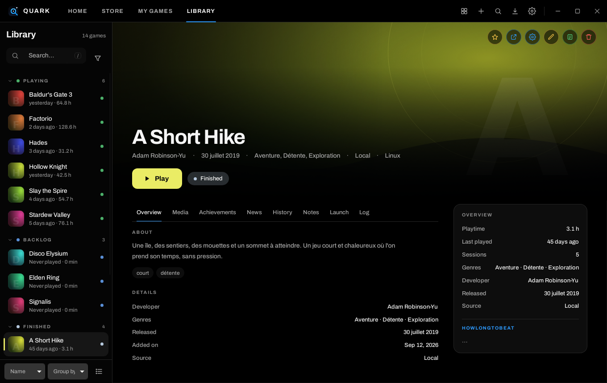
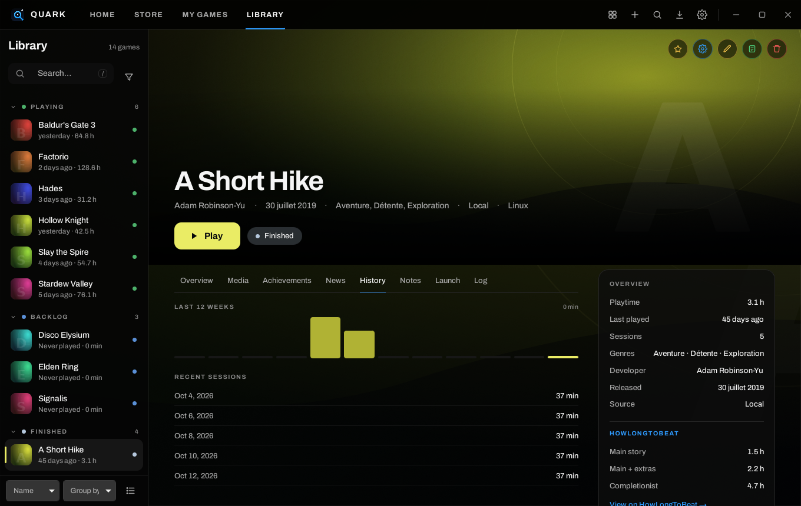
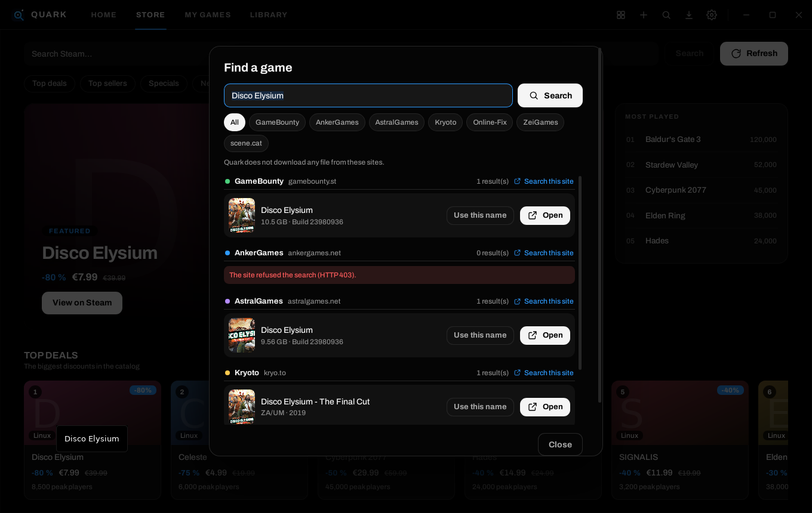

# Library and views

> [Home](Home) · [Getting started](Getting-Started) · **Library** ·
> [Stores](Stores-and-Saves) · [Settings](Settings)

## Two layouts

The library opens as a **list** with the game page on the right, or as a
**grid** of covers. The grid button in the top bar switches between them; the
choice is stored in the configuration and can also be changed in
**Settings → Appearance → Library layout**.

- **List**: one row per game, with a square icon, name, playtime, last use,
  status dot and selection marker. The selected game opens beside the list.
- **Grid**: covers only, for browsing a large library. Clicking a cover opens
  the game page full width.

Games whose executable is missing are shown in red. A game marked as running
keeps that state visible after switching pages.

## Search and filters

- The search field at the top of the library filters the current view.
- `Ctrl+F`, `/` or `Ctrl+K` opens the global search from any tab. It covers
  local games, games owned in a connected store, pages, actions and settings
  tasks. A store game opens in **My games**; a settings task opens the right
  page.
- Search ignores accents and requires a real substring. A query cannot match by
  scattering its letters across unrelated fields.
- `Escape` closes the search. The **Filters** button opens one panel for status,
  Steam genre and personal tags. The number of active filters appears on the
  button, and **Clear all** removes them at once.

## Sort, filter, group

**Sort**: name, last session, date added or playtime.

**Filters**: status (`To play`, `Playing`, `Completed`, `Dropped`), Steam genre
and personal tag. Filters combine, stay open while selecting and show their
count on the button. **Clear all** restores the full library.

List **grouping**:

- by **status**;
- by **store**;
- by **genre**;
- by **release year**;
- or no group, for one continuous list.

Group headers show a count and can be collapsed. Grouping does not change the
order of games inside a group.

## Saved views

The **Views** menu saves the current state: search, filters, sort and grouping.
A view can be applied or deleted later.

Three starter views are created once: **To play**, **Playing** and
**Completed**. If you delete them, they are not recreated on the next start.
Empty views, duplicates and filters pointing to a deleted tag or genre are
cleaned on load and save. The list is limited to 32 views.

## Home

Home is a full-width page reached from the **Home** tab. A carousel of recently
played games shows the hero image, logo or title, **Play/Stop**, playtime, last
session, the ProtonDB rating and the native-Linux badge. Below it, the
**Continue** rail lists the library as covers, sorted by last session, date
added or hours played.

The carousel can advance automatically; the delay is set in
**Settings → Appearance → Home**. The main button becomes **Stop** while the
game is running.

## Game page

The game page shows:

- the banner, logo or title and the ProtonDB/Linux badges;
- the **Play/Stop** button, playtime and last session;
- Overview, Media, Achievements, News, History, Notes, Launch and Log tabs;
- action icons on the banner: favorite, ProtonDB, customize, open the install
  folder and remove.

**Media** plays the Steam trailer in the page itself, then lists it before the
screenshots in a horizontal filmstrip. Click a screenshot to show it full size,
click the video to bring it back and start playback, and scroll the strip with
the wheel, a drag or the previous/next arrows.

**History** summarises sessions, shows the last twelve weeks and lists recent
play sessions. Playtime published by Epic or GOG replaces local playtime when
the store provides it; Steam Cloud remains managed by Steam.

**Customize** replaces or removes the cover, hero, logo and icon from
SteamGridDB, Steam, the store or a local file. The **Launch** tab holds the
per-game runtime, prefix, arguments, environment and compatibility options.

## Download sites

Search is disabled by default. Add the manifest URL to
`settings.extension_sources` in `~/.config/quark/config.json`, then restart
Quark. The banner action with the external-link icon then opens a search across
the sites declared by that manifest. The provided
`docs/extensions/quark-sites.json` restores **GameBounty**, **AnkerGames**,
**AstralGames**, **Kryoto**, **Online-Fix**, **ZeiGames** and **scene.cat**.
Store cards open the same dialog with the game name already filled in.

- Results are grouped by source in that fixed order. A source that fails shows
  its own message; the other results stay visible.
- **Use this name** fills the add-game dialog. **Open** opens the page in your
  browser.
- Quark only reads search pages. It never downloads, extracts or installs a
  file from these sites.

## Several installations for one game

A game has shared data (name, artwork, notes, tags, status, statistics) and one
or more **installations**. Each installation carries its store, folder,
executable, prefix, cloud save folder and install state.

- Selecting an installation changes the executable and prefix used by **Play**
  without touching the other editions.
- When an older `~/.local/share/quark/prefixes/<game>` prefix already exists, it
  is reused so saves do not become invisible.
- A real second installation gets a `<game>-<store>` prefix.
- Ludusavi snapshots are separated by installation: two editions of the same
  game never share a snapshot.

## Multi-selection and removal

`Ctrl+click` marks several games. The delete button opens a confirmation for the
selection. Removing an entry does not delete the game files: it only removes the
library entry. Prefixes, saves and installations stay on disk unless you
explicitly remove them in the relevant tools.

## Library shortcuts

| Key | Action |
| --- | --- |
| `↑` / `↓` | Select the previous or next game |
| `Enter` | Launch the selected game |
| `Ctrl+F` or `/` | Global search |
| `Escape` | Clear search or close a panel |
| `Ctrl+K` | Global search |
| `Ctrl+Q` | Quit Quark |

## Going further

- [Stores and saves](Stores-and-Saves)
- [Proton, Wine and launch options](Proton-Wine-and-Launch-Options)
- [Settings](Settings)

---

[Home](Home) · [Getting started](Getting-Started) · [Stores](Stores-and-Saves) · [Settings](Settings)
