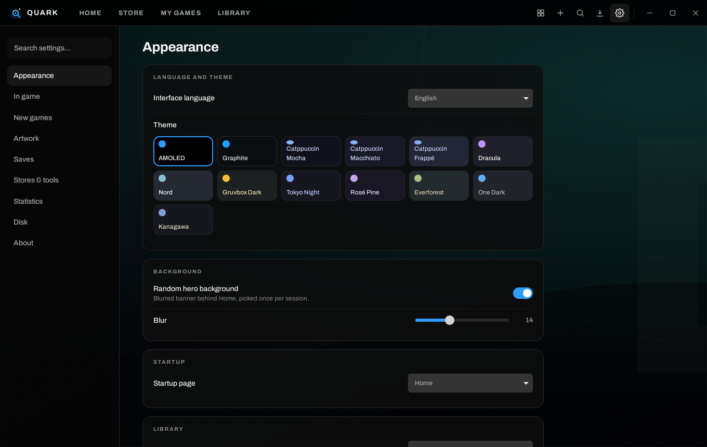

# Settings

> [Home](Home) · [Themes and appearance](Themes-and-Appearance) ·
> **Settings** · [Proton and Wine](Proton-Wine-and-Launch-Options)

Settings fill the whole window as cards, with side navigation and separate
sections. A search field above the navigation finds a setting by task (for
example **cloud saves**, **screenshots** or **disk**) and opens the page that
contains it. Every change is saved automatically; there is no **Apply** button.

## Appearance

- **Interface language**: French, English, Spanish, German, Portuguese or Russian, applied immediately.
- **Theme**: thirteen palettes, applied immediately.
- **Random hero background** and **Blur**: a blurred banner behind Home and
  Library, picked once per session.
- **Startup**: startup page (Home, Library, Store, My games).
- **Library**: list or grid layout, compact interface density and the default game tab.
- **Home**: carousel sort, automatic advance and interval.
- **Notification area**: keep Quark in the tray icon instead of quitting.

Details and screenshots: [Themes and appearance](Themes-and-Appearance).

## In game

- **Screenshots**: choose the global shortcut used to capture the active game.
- **Achievements**: show locked or compact rows, with progress and rarity.
- **Desktop notifications**: end of an installation, a Ludusavi backup or a
  game session. Each can be disabled independently; nothing is sent while the
  Quark window is focused.
- **Cloud saves**: Epic/GOG synchronization after installation and on exit.
- **Epic overlay (EOS)**: download and enable the EOS overlay in the game prefix
  when available.

The default screenshot shortcut is `F12`. See [Achievements](Achievements).

## New games

This page does **not** contain global settings. These values are copied into a
game when it is added. Each game then keeps its own; changing a default does not
affect existing games, and changing one game does not affect the others.

- **Proton prefix**: folder used as-is. Empty = automatic prefix under
  `~/.local/share/quark/prefixes/<game>`.
- **Store installation folder**: parent proposed for Epic/GOG. Empty = `~/Games`.
- **Arguments**: default arguments passed after the executable.
- **Proton runtime**: preferred runtime; **Automatic** lets Quark choose.
- **Anti-cheat**: BattlEye and EasyAntiCheat, two independent options.
- **Launch options**: GameMode, MangoHud, gamescope, PRIME, wrapper, PROTON_LOG,
  umu.
- **Environment variables**: format `NAME=value`, copied into each new game.

Detected runtimes and their count are shown on this page, with **Detect again**.
See [Proton, Wine and options](Proton-Wine-and-Launch-Options) for what each
option and variable does.

## Artwork

- **Sources**: SteamGridDB, Steam, store and local file.
- **SteamGridDB key**: optional, stored in the local configuration.
- **Download and replace** covers, heroes, logos and icons.
- **Cache**: downloaded images are kept in `~/.local/share/quark/artwork/`.

A game page also offers **Customize** to choose a specific image, including a
local file.

## Saves

- **Ludusavi backup folder**: where Quark stores local snapshots.
- **Ludusavi search folders**: one absolute path per line, added to each
  game's own save folders.
- **Snapshots**: created before a launch and after a session, with preview,
  inventory and restore on the game page.
- **Cloud saves**: Epic/GOG synchronization is enabled on the **In game** page.

See [Stores and saves](Stores-and-Saves).

## Stores & tools

- **Synchronization**: import or refresh the Steam, Epic and GOG libraries.
- **Accounts**: connect and disconnect Epic/GOG, optional Steam key.
- **Connections**: session state and synchronization actions.
- **Tools managed by Quark**: Legendary, gogdl, Ludusavi; install, update and
  SHA-256 verification.
- **Epic overlay (EOS)**: download and activation.

See [Stores and saves](Stores-and-Saves).

## Statistics

- Total playtime, playtime this week and day streak.
- Bars for the last twelve weeks.
- A 26-week heat map.
- Most played games.

Statistics come from the local session history. Playtime published by a store
can be shown on the game page, but the detailed history remains what Quark
observed.

## Disk

Background measurement of:

- Proton prefixes;
- artwork cache;
- logs;
- update archives;
- game folders.

The measurement can take time on a large library. It deletes nothing and offers
no automatic cleanup: the folder button opens the location so you can decide
what to remove.

## About

- Installed version.
- **Check for updates**, last check state, archive size and installation.
- **Install updates on startup**.
- **Review the guide**: reopen the welcome guide.
- **Release page**, resources and data folders.

Updates verify the SHA-256 and refuse a binary that does not match the expected
tag. See [Installation](Installation).

## Close settings

The **×** button in the top right closes the page. `Escape` also closes panels.
Settings do not interrupt an already started download, disk scan or
synchronization.

## See also

- [Themes and appearance](Themes-and-Appearance)
- [Proton, Wine and launch options](Proton-Wine-and-Launch-Options)
- [Stores and saves](Stores-and-Saves)
- [Troubleshooting](Troubleshooting)

---

[Home](Home) · [Themes](Themes-and-Appearance) · [Proton](Proton-Wine-and-Launch-Options) · [Troubleshooting](Troubleshooting)
